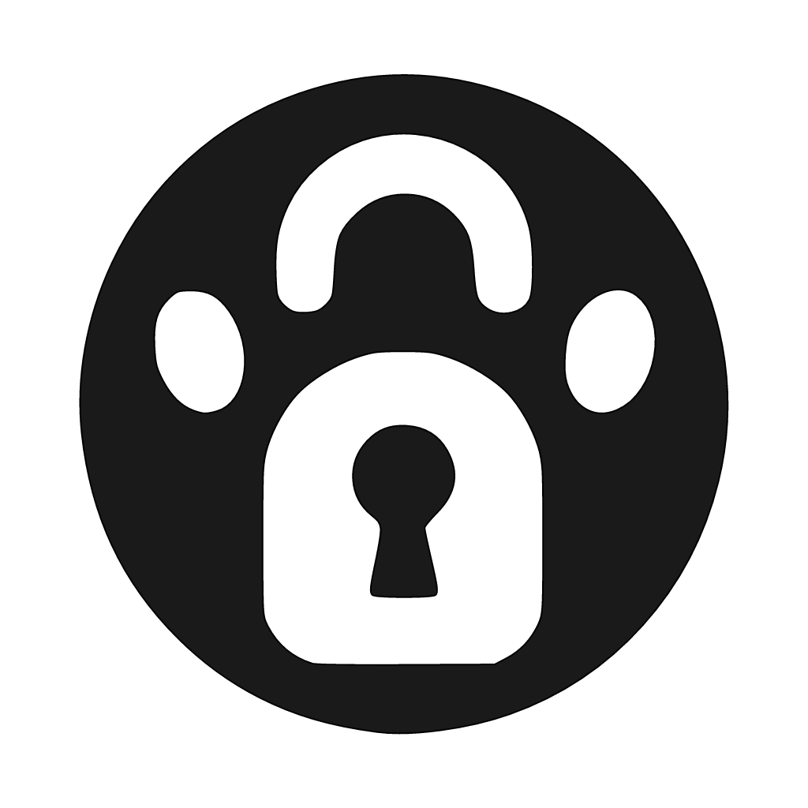
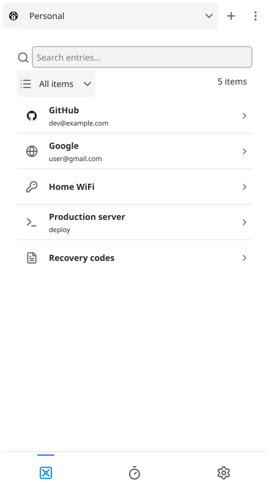
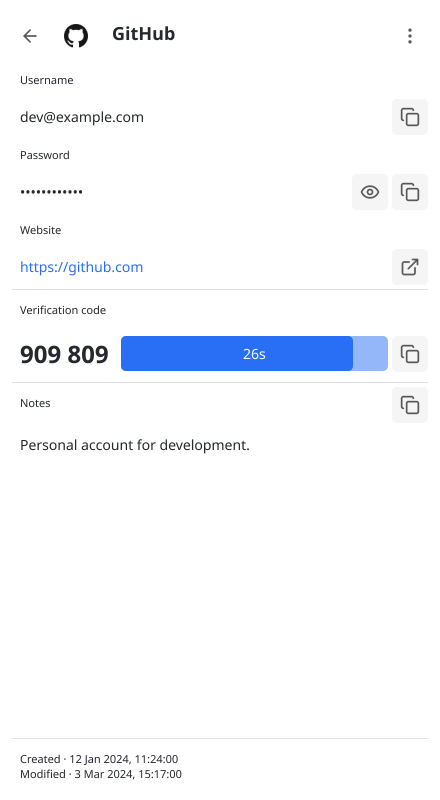

<div align="center">
    
</div>

# Simple, modern and privacy-focused open-source password manager

Paw is an offline-first password manager for storing logins, passwords, secure notes, SSH keys, and authenticator codes.

Paw is written in Go, uses [Fyne](https://github.com/fyne-io/fyne) for its interface, and uses [age](https://github.com/FiloSottile/age) to encrypt vault data.

## Warning

**This software is a work in progress and has not undergone a full security audit.**

**Do not expect it to be bug free and do not rely on it for any type of security.**

## Screenshot

<div>
    
    
</div>

## Main features

* Cross-platform desktop application for Linux, macOS, Windows, and FreeBSD
* Desktop GUI and CLI modes from the same executable
* SSH agent integration and browser extension support
* Password audits for exposed, weak, and reused passwords
* Authenticator code (TOTP) support
* File attachments for Login and Secure Note items
* Native CXF-based credential storage
* Password-protected `.paw` archive backup and restore, including attachments and history
* CXF-compatible backup export and restore, plus SSH key import and export

### Later goals

* Synchronization between devices
* Browser extension autofill
* CXF import from other password managers
* Support for more CXF credential types, including passkeys, credit cards, API keys, Wi-Fi credentials, and identity documents
* Email masking support
* Mobile app

## Installation

Download the latest stable packages from the [Releases page](https://github.com/lucor/paw/releases/latest). Packages are available for Linux (amd64 and arm64), macOS (Intel and Apple Silicon), Windows (amd64), and FreeBSD (amd64 and arm64).

### Linux

Download the `.tar.xz` package for your architecture and extract it. From the extracted directory containing the `Makefile`, run `make user-install` to install Paw for your user, or `sudo make install` to install it system-wide.

### macOS

Download the `.dmg` package for your Mac: `darwin_amd64` for Intel or `darwin_arm64` for Apple Silicon. Open the disk image and drag Paw to Applications. Because Paw is not notarized, remove the quarantine attribute after copying it:

```sh
xattr -r -d com.apple.quarantine /Applications/Paw.app
```

Run this command again after upgrading Paw.

### Windows

Download and run the `windows_amd64.exe` package.

### FreeBSD

Download and extract the `.tar.xz` package for your architecture. Install GNU Make (`gmake`) if needed, then from the extracted directory containing the `Makefile`, run `gmake user-install` to install Paw for your user, or `sudo gmake install` to install it system-wide.

## How vaults and passwords work

### Vault initialization

Paw stores credentials in one or more local vaults.

When creating a vault, Paw generates an age X25519 key and protects it with the master password using age's scrypt-based password encryption. Paw uses that key to encrypt the vault index and individual items. The vault name and appearance are kept separately as local listing metadata.

The protected key is stored in `key.age`, the encrypted vault index in `vault.age`, and each item in its own encrypted file. Item contents and their index summaries are encrypted; `metadata.json` contains the vault's unencrypted name, icon, and color so Paw can list locked vaults.

### Password generation

Random passwords and PINs use Go's `crypto/rand` directly and do not depend on the vault key. Random passwords use the selected character sets: lowercase letters, uppercase letters, numbers, and symbols. Passphrases join randomly selected English words with hyphens.

### Custom passwords

You can enter a password manually or edit a generated password before saving. Paw stores the current password field value.

### Backups

Paw supports plaintext `.cxf` and password-encrypted `.cxf.age` backups for CXF compatibility, plus password-encrypted `.paw` archives. A `.paw` archive uses its own password and includes item history and attachment files. CXF backups cannot contain attachment binaries, so Paw rejects CXF exports when the vault contains attachments. Restoring any supported backup creates a separate vault with a new master password and encryption key; it does not overwrite or merge existing vaults.

### Items

Paw supports these item types:

* Login: username, password, website, optional authenticator key, notes, and file attachments
* Password: a standalone password
* Secure note: multiline text and file attachments
* SSH key: public and private key material, with an optional passphrase

## Threat model

The threat model of Paw assumes there are no attackers on your local machine.

## License

This project is licensed under the GNU Affero General Public License v3.0 or later (AGPL-3.0-or-later), unless otherwise noted. See the [LICENSE](LICENSE) file for details.

Some components may be licensed under different terms - see individual file headers for specific licensing information and the [THIRD_PARTY_LICENSES](THIRD_PARTY_LICENSES) file for third-party dependencies.

## Contribute

See <https://lucor.dev/projects/#maintenance-policy>

## Credits

* [age](https://github.com/FiloSottile/age) for the encryption library
* [Fyne](https://github.com/fyne-io/fyne) for the UI toolkit
* [Lucide](https://lucide.dev/) for the current UI icon set

Also thanks to these Open Source password managers that inspired Paw:

* [gopass](https://github.com/gopasspw/gopass)
* [lesspass](https://github.com/lesspass/lesspass)
* [pass](https://www.passwordstore.org/)
* [passage](https://github.com/FiloSottile/passage)
* [passgo](https://github.com/ejcx/passgo)
