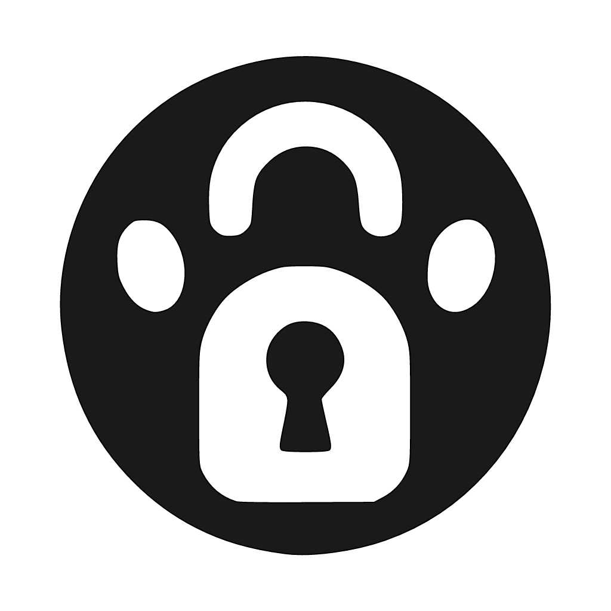
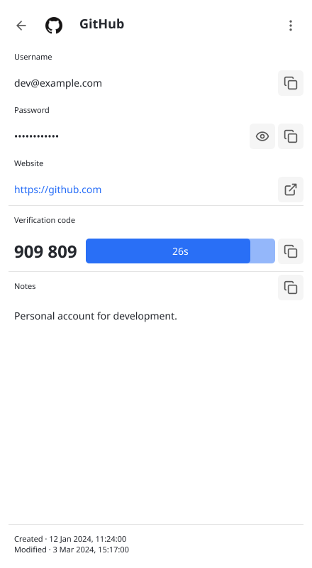

<div align="center">
    
</div>

# Simply a password manager

Paw stores your data locally in files encrypted with [age](https://age-encryption.org). It works offline and doesn't require an account.

Free and open source.

Paw provides a desktop app and command-line interface in a single binary. Run `paw` to open the desktop app or `paw cli` to use the command line. Both access the same local vaults.

See the [documentation](https://paw.pm/docs/) for installation and usage instructions.

## Warning

**This software is a work in progress and has not undergone a full security audit.**

**Do not expect it to be bug free and do not rely on it for any type of security.**

## Screenshots

<table>
    <tr>
        <td><a href="images/list.png"></a></td>
        <td><a href="images/details.png"></a></td>
    </tr>
</table>

## Main features

* Cross-platform desktop application for Linux, macOS, Windows, and FreeBSD
* Desktop GUI and CLI modes from the same executable
* SSH agent integration and browser extension support
* Password audits for exposed, weak, and reused passwords
* Authenticator code (TOTP) support
* File attachments for Login and Secure Note items
* Native CXF-based credential storage
* Password-protected `.paw` archive backup and restore, including attachments and history
* CXF-compatible backup export and restore, plus SSH key import and export

### Later goals

* Synchronization between devices
* Browser extension autofill
* CXF import from other password managers
* Support for more CXF credential types, including passkeys, credit cards, API keys, Wi-Fi credentials, and identity documents
* Email masking support
* Mobile app

## Installation

Download the latest stable packages from the [Releases page](https://github.com/lucor/paw/releases/latest). Packages are available for Linux (amd64 and arm64), macOS (Intel and Apple Silicon), Windows (amd64), and FreeBSD (amd64 and arm64).

### Linux

Download the `.tar.xz` package for your architecture and extract it. From the extracted directory containing the `Makefile`, run `make user-install` to install Paw for your user, or `sudo make install` to install it system-wide.

### macOS

Download the `.dmg` package for your Mac: `darwin_amd64` for Intel or `darwin_arm64` for Apple Silicon. Open the disk image and drag Paw to Applications. Because Paw is not notarized, remove the quarantine attribute after copying it:

```sh
xattr -r -d com.apple.quarantine /Applications/Paw.app
```

Run this command again after upgrading Paw.

### Windows

Download and run the `windows_amd64.exe` package.

### FreeBSD

Download and extract the `.tar.xz` package for your architecture. Install GNU Make (`gmake`) if needed, then from the extracted directory containing the `Makefile`, run `gmake user-install` to install Paw for your user, or `sudo gmake install` to install it system-wide.

### Install with Go

If your system has a version of Go supported by Paw, install the latest published release:

```sh
go install go.lucor.dev/paw@latest
```

You also need a C compiler and the platform libraries listed in the [Fyne build requirements](https://docs.fyne.io/started/).

To build from source instead, clone the repository and install the executable:

```sh
git clone https://github.com/lucor/paw.git
cd paw
go install .
```

Go installs `paw` in `GOBIN`, or in `GOPATH/bin` when `GOBIN` is not set. Add that directory to your `PATH` to run `paw` and `paw cli`.

## How vaults and passwords work

### Vault initialization

Paw stores credentials in one or more local vaults.

New vaults use a hybrid post-quantum age identity combining X25519 and ML-KEM-768. Paw protects it with the master password using age's scrypt-based password encryption and uses it to encrypt the vault index, items, history, and attachments. Existing vaults are upgraded automatically the next time they are successfully unlocked; the master password stays the same. The upgrade stages a second encrypted copy and may temporarily need additional disk space. Back up your vault before upgrading Paw. Older Paw versions may not be able to open an upgraded vault.

The protected identity is stored in `identities/scrypt.age`, the encrypted vault index in `vault.age`, and each item in its own encrypted file. Item contents and their index summaries are encrypted; `metadata.json` contains the vault's unencrypted name, icon, and color so Paw can list locked vaults.

### Password generation

Random passwords and PINs use Go's `crypto/rand` directly and do not depend on the vault key. Random passwords use the selected character sets: lowercase letters, uppercase letters, numbers, and symbols. Passphrases join randomly selected English words with hyphens.

### Custom passwords

You can enter a password manually or edit a generated password before saving. Paw stores the current password field value.

### Backups

Paw supports plaintext `.cxf` and password-encrypted `.cxf.age` backups for CXF compatibility, plus password-encrypted `.paw` archives. A `.paw` archive uses its own password and includes item history and attachment files. CXF backups cannot contain attachment binaries, so Paw rejects CXF exports when the vault contains attachments. Restoring any supported backup creates a separate vault with a new master password and encryption key; it does not overwrite or merge existing vaults.

### Items

Paw supports these item types:

* Login: username, password, website, optional authenticator key, notes, and file attachments
* Password: a standalone password
* Secure note: multiline text and file attachments
* SSH key: public and private key material, with an optional passphrase

## Threat model

The threat model of Paw assumes there are no attackers on your local machine.

## License

This project is licensed under the GNU Affero General Public License v3.0 or later (AGPL-3.0-or-later), unless otherwise noted. See the [LICENSE](LICENSE) file for details.

Some components may be licensed under different terms - see individual file headers for specific licensing information and the [THIRD_PARTY_LICENSES](THIRD_PARTY_LICENSES) file for third-party dependencies.

## Contribute

See <https://lucor.dev/projects/#maintenance-policy>

## Credits

Paw is built with:

* [Go](https://go.dev/) — programming language
* [age](https://age-encryption.org) — encryption
* [Fyne](https://github.com/fyne-io/fyne) — graphical interface
* [Lucide](https://lucide.dev/) — icons
* [zxcvbn](https://github.com/lucor/zxcvbn) — password strength estimation (adapted fork)

Paw also uses [Have I Been Pwned](https://haveibeenpwned.com/Passwords) for optional compromised-password checks.

For a complete list of third-party dependencies and their licenses, see [Third-party licenses](/THIRD_PARTY_LICENSES).

Also thanks to [pass](https://www.passwordstore.org/) and the other open-source password managers that inspired Paw.
