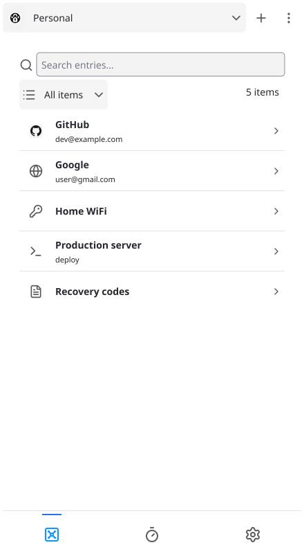

<div align="center">
    
</div>

# Simply a password manager

Paw stores your data locally in files encrypted with [age](https://age-encryption.org). It works offline and doesn't require an account.

Free and open source.

Paw provides a desktop app and command-line interface in a single binary, plus an Android app. Run `paw` to open the desktop app or `paw cli` to use the command line. Both access the same local vaults.

See the [documentation](https://paw.pm/docs/) for installation and usage instructions.

> [!WARNING]
> Paw is a work in progress and has not yet undergone an independent security audit. Read the [threat model](https://paw.pm/docs/security/threat-model/) before trusting it with important secrets.

## Screenshots

<table>
    <tr>
        <td><a href="images/list.png"></a></td>
        <td><a href="images/details.png"></a></td>
    </tr>
</table>

## Main features

* Desktop application for Linux, macOS, Windows, and FreeBSD
* Android app for arm64 devices
* Desktop GUI and CLI modes from the same executable
* Hybrid post-quantum age encryption (X25519 and ML-KEM-768)
* Vault synchronization and cloning directly between devices on the local network
* SSH agent integration and browser extension support
* Password audits for exposed, weak, and reused passwords
* Authenticator code (TOTP) support
* File attachments for Login and Secure Note items
* CXF-based credential storage
* Password-protected `.paw` archive backup and restore, including attachments and history
* CXF-compatible backup export and restore, plus SSH key import and export

### Later goals

* Browser extension autofill
* CXF import from other password managers
* Support for more CXF credential types, including passkeys, credit cards, API keys, Wi-Fi credentials, and identity documents
* Email masking support

## Installation

Install Paw using Homebrew on macOS and Linux, download a pre-built package from GitHub Releases, or install with Go.

### Homebrew (macOS and Linux)

Install the [Lucor Homebrew tap](https://github.com/lucor/homebrew-tap):

```sh
brew install --cask lucor/tap/paw
```

The qualified command adds the tap if needed. You can also add the tap first:

```sh
brew tap lucor/tap
brew install --cask lucor/tap/paw
```

On Linux, a current Homebrew installation with Linux cask support is required. The Homebrew `bin` directory must be on the `PATH` used by your desktop session for the Paw desktop launcher to run.

### Download a release

Download the latest stable packages from the [Releases page](https://github.com/lucor/paw/releases/latest). Packages are available for Linux (amd64 and arm64), macOS (Intel and Apple Silicon), Windows (amd64), FreeBSD (amd64 and arm64), and Android (arm64).

#### Android

Download the arm64 `.apk` from the [Releases page](https://github.com/lucor/paw/releases/latest) to your device and open it to install Paw. Android may ask you to allow the browser or file manager opening the APK to install unknown apps. Enable **Allow from this source**, return to the APK, and complete the installation. You can turn off this permission afterward.

#### Linux

Download the `.tar.xz` package for your architecture and extract it. From the extracted directory containing the `Makefile`, run `make user-install` to install Paw for your user, or `sudo make install` to install it system-wide.

#### macOS

Download the `.dmg` package for your Mac: `darwin_amd64` for Intel or `darwin_arm64` for Apple Silicon. Open the disk image and drag Paw to Applications. Because Paw is not notarized, remove the quarantine attribute after copying it:

```sh
xattr -r -d com.apple.quarantine /Applications/Paw.app
```

Run this command again after upgrading Paw.

#### Windows

Download and run the `.exe` package for amd64.

#### FreeBSD

Download and extract the `.tar.xz` package for your architecture. Install GNU Make (`gmake`) if needed, then from the extracted directory containing the `Makefile`, run `gmake user-install` to install Paw for your user, or `sudo gmake install` to install it system-wide.

### Install with Go

If your system has a version of Go supported by Paw, install the latest published release:

```sh
go install go.lucor.dev/paw@latest
```

You also need a C compiler and the platform libraries listed in the [Fyne build requirements](https://docs.fyne.io/started/).

To build from source instead, clone the repository and install the executable:

```sh
git clone https://github.com/lucor/paw.git
cd paw
go install .
```

Go installs `paw` in `GOBIN`, or in `GOPATH/bin` when `GOBIN` is not set. Add that directory to your `PATH` to run `paw` and `paw cli`.

## Usage

Run `paw` to open the desktop app, or use `paw cli` for command-line operations:

```sh
# Create a vault
paw cli init Personal

# Add an item (Paw prompts for the fields)
paw cli add Personal/login/GitHub

# Show an item (use --clip to copy the password instead of printing it)
paw cli show Personal/login/GitHub
```

Commands that select an existing vault accept its name, full Vault ID, or a unique Vault ID prefix of at least 7 characters (for example, `paw cli unlock Personal` and `paw cli unlock mjqxgz2` select the same vault).

Details: [Command reference](https://paw.pm/docs/cli/commands/) and [Desktop app](https://paw.pm/docs/desktop/).

## How vaults and passwords work

### Vault initialization

Paw stores credentials in one or more local vaults. Each vault uses a hybrid post-quantum age identity combining X25519 and ML-KEM-768, protected by the master password with age's scrypt-based password encryption. All vault data is encrypted at rest; only the vault name, icon, and color are stored unencrypted in `metadata.json` so Paw can list locked vaults.

Details: [Vault encryption](https://paw.pm/docs/security/vault-encryption/) and [Storage layout](https://paw.pm/docs/security/storage-layout/).

### Items

Paw supports Login, Password, Secure note, and SSH key items, with item history and encrypted file attachments.

Details: [Items and history](https://paw.pm/docs/data/items-history/).

### Password generation

Passwords, passphrases, and PINs are generated with Go's `crypto/rand` and do not depend on the vault key. You can also enter a password manually.

Details: [Password generator](https://paw.pm/docs/desktop/) and the [`pwgen` command](https://paw.pm/docs/cli/commands/).

### Backups

Paw exports password-protected `.paw` archives (including attachments and item history), password-encrypted `.cxf.age`, and plaintext `.cxf` CXF documents. CXF exports cannot contain attachments. Restoring a backup always creates a separate vault with a new master password; it does not overwrite or merge existing vaults.

Details: [Backup and restore](https://paw.pm/docs/backup-restore/).

### Vault synchronization and cloning

Paw synchronizes and clones vaults directly between devices on the same local network, without cloud servers. Sync uses mDNS discovery, mutual TLS 1.3 with post-quantum key exchange, and ML-DSA-44 authentication. First-time pairing requires confirming a 6-digit code on both devices.

* **In the desktop app**: see [Vault synchronization](https://paw.pm/docs/desktop/).
* **In the CLI**: run `paw cli sync <vault>` to synchronize or `paw cli sync --clone` to clone. If mDNS discovery is unavailable, connect directly with `--link`.
* **Protocol details**: [Sync protocol & cryptography](https://paw.pm/docs/security/sync-protocol/).

The device Sync identity is stored in the local vault directory as `sync.age`. It is device-specific; do not copy this file to another device.

## Threat model

The threat model of Paw assumes there are no attackers on your local machine. See the full [threat model](https://paw.pm/docs/security/threat-model/).

To report a security issue or vulnerability, follow the [security policy](https://github.com/lucor/paw/security/policy).

## License

This project is licensed under the GNU Affero General Public License v3.0 or later (AGPL-3.0-or-later), unless otherwise noted. See the [LICENSE](LICENSE) file for details.

Some components may be licensed under different terms - see individual file headers for specific licensing information and the [THIRD_PARTY_LICENSES](THIRD_PARTY_LICENSES) file for third-party dependencies.

## Contribute

See <https://lucor.dev/projects/#maintenance-policy>

## Credits

Paw is built with:

* [Go](https://go.dev/) — programming language
* [age](https://age-encryption.org) — encryption
* [Fyne](https://github.com/fyne-io/fyne) — graphical interface
* [Lucide](https://lucide.dev/) — icons
* [zxcvbn](https://github.com/lucor/zxcvbn) — password strength estimation (adapted fork)

Paw also uses [Have I Been Pwned](https://haveibeenpwned.com/Passwords) for optional compromised-password checks.

Also thanks to [pass](https://www.passwordstore.org/) and the other open-source password managers that inspired Paw.
